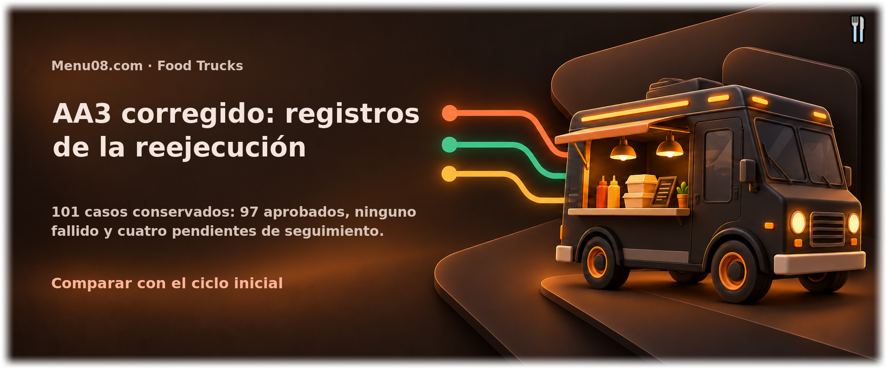

<!-- Menu08.com:header -->

<!-- /Menu08.com:header -->

# Resultados del ciclo corregido AA3

Commit probado: `0e7f3bc144777b1768cd9571f5f1058205fb6fe7`.

Casos: 101. Aprobados: 97; fallidos: 0; pendientes: 4.

Las correcciones de los cuatro casos iniciales están verificadas localmente. HTTPS requiere desplegar el PR para cerrar el criterio del hosting. Los registros iniciales están en [../inicial](../inicial/README.md).

| Caso | Nombre | Estado | Registro | Captura del informe |
|---|---|---|---|---|
| CP-CARTA-01 | Ingreso con el rol food_truck | Aprobada | [JSON](CP-CARTA-01.json) | [PNG](CP-CARTA-01-informe.png) |
| CP-CARTA-02 | Ingreso con la contraseña equivocada | Aprobada | [JSON](CP-CARTA-02.json) | [PNG](CP-CARTA-02-informe.png) |
| CP-CARTA-03 | Cierre de sesión | Aprobada | [JSON](CP-CARTA-03.json) | [PNG](CP-CARTA-03-informe.png) |
| CP-CARTA-04 | Un cajero no entra al panel de CARTA | Aprobada | [JSON](CP-CARTA-04.json) | [PNG](CP-CARTA-04-informe.png) |
| CP-CARTA-05 | Alta de categoría | Aprobada | [JSON](CP-CARTA-05.json) | [PNG](CP-CARTA-05-informe.png) |
| CP-CARTA-06 | Edición de categoría | Aprobada | [JSON](CP-CARTA-06.json) | [PNG](CP-CARTA-06-informe.png) |
| CP-CARTA-07 | Alta de producto con foto | Aprobada | [JSON](CP-CARTA-07.json) | [PNG](CP-CARTA-07-informe.png) |
| CP-CARTA-08 | Producto marcado como no disponible | Aprobada | [JSON](CP-CARTA-08.json) | [PNG](CP-CARTA-08-informe.png) |
| CP-CARTA-09 | Baja lógica de categoría | Aprobada | [JSON](CP-CARTA-09.json) | [PNG](CP-CARTA-09-informe.png) |
| CP-CARTA-10 | La carta pública dice lo que dice la base | Aprobada | [JSON](CP-CARTA-10.json) | [PNG](CP-CARTA-10-informe.png) |
| CP-CARTA-11 | Slug inexistente | Aprobada | [JSON](CP-CARTA-11.json) | [PNG](CP-CARTA-11-informe.png) |
| CP-CARTA-12 | Food truck desactivado | Aprobada | [JSON](CP-CARTA-12.json) | [PNG](CP-CARTA-12-informe.png) |
| CP-CARTA-13 | Código QR | Aprobada | [JSON](CP-CARTA-13.json) | [PNG](CP-CARTA-13-informe.png) |
| CP-CARTA-14 | Un food truck no administra el catálogo de otro | Aprobada | [JSON](CP-CARTA-14.json) | [PNG](CP-CARTA-14-informe.png) |
| CP-CARTA-15 | Contraste con la carta publicada | Aprobada | [JSON](CP-CARTA-15.json) | [PNG](CP-CARTA-15-informe.png) |
| CP-CARTA-16 | La carta a 320 px | Aprobada | [JSON](CP-CARTA-16.json) | [PNG](CP-CARTA-16-informe.png) |
| CP-CARTA-17 | Normalización de precios con separadores de miles y decimales | Aprobada | [JSON](CP-CARTA-17.json) | [PNG](CP-CARTA-17-informe.png) |
| CP-CARTA-18 | Rechazo de precio inválido, nombre repetido y campos obligatorios | Aprobada | [JSON](CP-CARTA-18.json) | [PNG](CP-CARTA-18-informe.png) |
| CP-CARTA-19 | Tipo real, límite de 2 MB y limpieza de imágenes rechazadas | Aprobada | [JSON](CP-CARTA-19.json) | [PNG](CP-CARTA-19-informe.png) |
| CP-CARTA-20 | Edición de producto propio y conservación de su identificador | Aprobada | [JSON](CP-CARTA-20.json) | [PNG](CP-CARTA-20-informe.png) |
| CP-CARTA-21 | Edición de datos del truck y rechazo de slug duplicado | Aprobada | [JSON](CP-CARTA-21.json) | [PNG](CP-CARTA-21-informe.png) |
| CP-CARTA-22 | Alta de parada nocturna del domingo | Aprobada | [JSON](CP-CARTA-22.json) | [PNG](CP-CARTA-22-informe.png) |
| CP-CARTA-23 | Edición y alternancia de baja lógica de una parada | Aprobada | [JSON](CP-CARTA-23.json) | [PNG](CP-CARTA-23-informe.png) |
| CP-CARTA-24 | Límites de apertura y cierre de una jornada diurna | Aprobada | [JSON](CP-CARTA-24.json) | [PNG](CP-CARTA-24-informe.png) |
| CP-CARTA-25 | Vigencia de la parada del sábado al cruzar medianoche | Aprobada | [JSON](CP-CARTA-25.json) | [PNG](CP-CARTA-25-informe.png) |
| CP-CARTA-26 | Cambio de semana de domingo a lunes | Aprobada | [JSON](CP-CARTA-26.json) | [PNG](CP-CARTA-26-informe.png) |
| CP-CARTA-27 | Rechazo de día, horas, coordenadas y punto inválidos | Aprobada | [JSON](CP-CARTA-27.json) | [PNG](CP-CARTA-27-informe.png) |
| CP-CARTA-28 | Exclusión de paradas desactivadas en vigencia y carta | Aprobada | [JSON](CP-CARTA-28.json) | [PNG](CP-CARTA-28-informe.png) |
| CP-CARTA-29 | Tratamiento seguro de momento y nombre con cadenas SQL | Aprobada | [JSON](CP-CARTA-29.json) | [PNG](CP-CARTA-29-informe.png) |
| CP-CARTA-30 | Coherencia de zona horaria de PHP y MySQL | Aprobada | [JSON](CP-CARTA-30.json) | [PNG](CP-CARTA-30-informe.png) |
| CP-CARTA-31 | Batería unitaria de coordenadas, horas, días, medianoche y redirección HTTPS | Aprobada | [JSON](CP-CARTA-31.json) | [PNG](CP-CARTA-31-informe.png) |
| CP-CARTA-32 | Presentación del acceso, navegación y formularios del panel | Aprobada | [JSON](CP-CARTA-32.json) | [PNG](CP-CARTA-32-informe.png) |
| CP-CARTA-33 | Carta pública sin catálogo publicado y controles de lectura móvil | Aprobada | [JSON](CP-CARTA-33.json) | [PNG](CP-CARTA-33-informe.png) |
| CP-CARTA-34 | Parada vigente, siguiente programada y agenda agrupada | Aprobada | [JSON](CP-CARTA-34.json) | [PNG](CP-CARTA-34-informe.png) |
| CP-CAJA-01 | Apertura de turno con base válida | Aprobada | [JSON](CP-CAJA-01.json) | [PNG](CP-CAJA-01-informe.png) |
| CP-CAJA-02 | Apertura rechazada con base inválida | Aprobada | [JSON](CP-CAJA-02.json) | [PNG](CP-CAJA-02-informe.png) |
| CP-CAJA-03 | Apertura rechazada con turno ya vigente | Aprobada | [JSON](CP-CAJA-03.json) | [PNG](CP-CAJA-03-informe.png) |
| CP-CAJA-04 | Armado de la orden desde el catálogo en vista de caja | Aprobada | [JSON](CP-CAJA-04.json) | [PNG](CP-CAJA-04-informe.png) |
| CP-CAJA-05 | Filtrado por categoría en el catálogo | Aprobada | [JSON](CP-CAJA-05.json) | [PNG](CP-CAJA-05-informe.png) |
| CP-CAJA-06 | Orden 1 — pago en efectivo y verificación SQL de ítems | Aprobada | [JSON](CP-CAJA-06.json) | [PNG](CP-CAJA-06-informe.png) |
| CP-CAJA-07 | Orden 2 — pago con tarjeta, nota especial y verificación SQL | Aprobada | [JSON](CP-CAJA-07.json) | [PNG](CP-CAJA-07-informe.png) |
| CP-CAJA-08 | Orden 3 — pago por transferencia con precio de centavos y verificación SQL | Aprobada | [JSON](CP-CAJA-08.json) | [PNG](CP-CAJA-08-informe.png) |
| CP-CAJA-09 | Orden vacía rechazada | Aprobada | [JSON](CP-CAJA-09.json) | [PNG](CP-CAJA-09-informe.png) |
| CP-CAJA-10 | Intento de venta con turno cerrado | Aprobada | [JSON](CP-CAJA-10.json) | [PNG](CP-CAJA-10-informe.png) |
| CP-CAJA-11 | Detalle del comprobante de una orden | Aprobada | [JSON](CP-CAJA-11.json) | [PNG](CP-CAJA-11-informe.png) |
| CP-CAJA-12 | Vista de impresión de 80 mm y exportación a PDF | Pendiente de seguimiento | [JSON](CP-CAJA-12.json) | [PNG](CP-CAJA-12-informe.png) |
| CP-CAJA-13 | Cuadre del turno antes de cerrar y contraste con cálculo manual | Aprobada | [JSON](CP-CAJA-13.json) | [PNG](CP-CAJA-13-informe.png) |
| CP-CAJA-14 | Desglose por medio de pago en el cuadre y verificación SQL | Aprobada | [JSON](CP-CAJA-14.json) | [PNG](CP-CAJA-14-informe.png) |
| CP-CAJA-15 | Cierre de turno con faltante y verificación en base de datos | Aprobada | [JSON](CP-CAJA-15.json) | [PNG](CP-CAJA-15-informe.png) |
| CP-CAJA-16 | Historial de turnos | Aprobada | [JSON](CP-CAJA-16.json) | [PNG](CP-CAJA-16-informe.png) |
| CP-CAJA-17 | Cantidad máxima por producto: 99 admitida, 100 rechazada | Aprobada | [JSON](CP-CAJA-17.json) | [PNG](CP-CAJA-17-informe.png) |
| CP-CAJA-18 | Rechazo de producto agotado, ajeno o inexistente | Aprobada | [JSON](CP-CAJA-18.json) | [PNG](CP-CAJA-18-informe.png) |
| CP-CAJA-19 | Importes manipulados en el navegador ignorados por el servidor | Aprobada | [JSON](CP-CAJA-19.json) | [PNG](CP-CAJA-19-informe.png) |
| CP-CAJA-20 | Rechazo de medio de pago ausente o inválido | Aprobada | [JSON](CP-CAJA-20.json) | [PNG](CP-CAJA-20-informe.png) |
| CP-CAJA-21 | Reversión de la venta si falla la inserción del detalle | Aprobada | [JSON](CP-CAJA-21.json) | [PNG](CP-CAJA-21-informe.png) |
| CP-CAJA-22 | Conservación del nombre y precio históricos al editar el producto | Aprobada | [JSON](CP-CAJA-22.json) | [PNG](CP-CAJA-22-informe.png) |
| CP-CAJA-23 | Reenvío de un formulario con token ya utilizado | Aprobada | [JSON](CP-CAJA-23.json) | [PNG](CP-CAJA-23-informe.png) |
| CP-CAJA-24 | Rechazo de declarado negativo, texto o vacío | Aprobada | [JSON](CP-CAJA-24.json) | [PNG](CP-CAJA-24-informe.png) |
| CP-CAJA-25 | Cierre sin ventas y negativas cuando no queda turno abierto | Aprobada | [JSON](CP-CAJA-25.json) | [PNG](CP-CAJA-25-informe.png) |
| CP-CAJA-26 | Cambio calculado y bloqueo por efectivo recibido insuficiente | Aprobada | [JSON](CP-CAJA-26.json) | [PNG](CP-CAJA-26-informe.png) |
| CP-SVP-01 | Tablero con ventanilla cerrada (sin turno abierto) | Aprobada | [JSON](CP-SVP-01.json) | [PNG](CP-SVP-01-informe.png) |
| CP-SVP-02 | Tablero con turno abierto y producción al día (sin órdenes en curso) | Aprobada | [JSON](CP-SVP-02.json) | [PNG](CP-SVP-02-informe.png) |
| CP-SVP-03 | Una orden registrada en CAJA aparece en el tablero como pendiente | Aprobada | [JSON](CP-SVP-03.json) | [PNG](CP-SVP-03-informe.png) |
| CP-SVP-04 | Tres órdenes registradas en CAJA aparecen en el tablero | Aprobada | [JSON](CP-SVP-04.json) | [PNG](CP-SVP-04-informe.png) |
| CP-SVP-05 | Avance de estado: pendiente → en preparación | Aprobada | [JSON](CP-SVP-05.json) | [PNG](CP-SVP-05-informe.png) |
| CP-SVP-06 | Avance de estado: en preparación → lista | Aprobada | [JSON](CP-SVP-06.json) | [PNG](CP-SVP-06-informe.png) |
| CP-SVP-07 | Avance de estado: lista → entregada, y la orden sale del tablero | Aprobada | [JSON](CP-SVP-07.json) | [PNG](CP-SVP-07-informe.png) |
| CP-SVP-08 | El sondeo actualiza el tablero sin recargar la página | Aprobada | [JSON](CP-SVP-08.json) | [PNG](CP-SVP-08-informe.png) |
| CP-SVP-09 | Dos órdenes en estados distintos coexisten en el tablero | Aprobada | [JSON](CP-SVP-09.json) | [PNG](CP-SVP-09-informe.png) |
| CP-SVP-10 | La segunda orden pasa a entregada y sale del tablero; T6-003 permanece | Aprobada | [JSON](CP-SVP-10.json) | [PNG](CP-SVP-10-informe.png) |
| CP-SVP-11 | Umbral de demora a los 10 minutos | Aprobada | [JSON](CP-SVP-11.json) | [PNG](CP-SVP-11-informe.png) |
| CP-SVP-12 | Rechazo de salto, estado inexistente y orden entregada | Aprobada | [JSON](CP-SVP-12.json) | [PNG](CP-SVP-12-informe.png) |
| CP-SVP-13 | Marcas cronológicas y duración conservada tras entregar | Aprobada | [JSON](CP-SVP-13.json) | [PNG](CP-SVP-13-informe.png) |
| CP-SVP-14 | Estructura y tipos del servicio de órdenes | Aprobada | [JSON](CP-SVP-14.json) | [PNG](CP-SVP-14-informe.png) |
| CP-SVP-15 | Estados visibles y privacidad del servicio público de turnos | Aprobada | [JSON](CP-SVP-15.json) | [PNG](CP-SVP-15-informe.png) |
| CP-SVP-16 | Turnos públicos sin turno y con turno abierto sin órdenes visibles | Aprobada | [JSON](CP-SVP-16.json) | [PNG](CP-SVP-16-informe.png) |
| CP-SVP-17 | Slug inexistente e inactivo en turnos públicos | Aprobada | [JSON](CP-SVP-17.json) | [PNG](CP-SVP-17-informe.png) |
| CP-SVP-18 | Pérdida de red, recuperación y sesión caducada | Aprobada | [JSON](CP-SVP-18.json) | [PNG](CP-SVP-18-informe.png) |
| CP-SVP-19 | Resoluciones del plan y temas claro y oscuro | Pendiente de seguimiento | [JSON](CP-SVP-19.json) | [PNG](CP-SVP-19-informe.png) |
| CP-SVP-20 | Comportamiento del tablero al cerrar el turno con órdenes en curso | Pendiente de seguimiento | [JSON](CP-SVP-20.json) | [PNG](CP-SVP-20-informe.png) |
| CP-SVP-21 | Dos consultas como máximo y respuesta menor a un segundo | Aprobada | [JSON](CP-SVP-21.json) | [PNG](CP-SVP-21-informe.png) |
| CP-SEG-01 | Inyección SQL en el inicio de sesión | Aprobada | [JSON](CP-SEG-01.json) | [PNG](CP-SEG-01-informe.png) |
| CP-SEG-02 | Inyección SQL en el slug de la carta | Aprobada | [JSON](CP-SEG-02.json) | [PNG](CP-SEG-02-informe.png) |
| CP-SEG-03 | Inyección SQL en el parámetro categoria | Aprobada | [JSON](CP-SEG-03.json) | [PNG](CP-SEG-03-informe.png) |
| CP-SEG-04 | Claves maliciosas en cantidad y mezcla con una línea válida | Aprobada | [JSON](CP-SEG-04.json) | [PNG](CP-SEG-04-informe.png) |
| CP-SEG-05 | XSS persistente en nombre y descripción de producto | Aprobada | [JSON](CP-SEG-05.json) | [PNG](CP-SEG-05-informe.png) |
| CP-SEG-06 | Acceso de cada rol y visitantes a las zonas privadas | Aprobada | [JSON](CP-SEG-06.json) | [PNG](CP-SEG-06-informe.png) |
| CP-SEG-07 | CSRF ausente o alterado en todos los POST web | Aprobada | [JSON](CP-SEG-07.json) | [PNG](CP-SEG-07-informe.png) |
| CP-SEG-08 | Negativas JSON por sesión, rol y token en SVP | Aprobada | [JSON](CP-SEG-08.json) | [PNG](CP-SEG-08-informe.png) |
| CP-SEG-09 | Recursos ajenos indistinguibles de recursos inexistentes | Aprobada | [JSON](CP-SEG-09.json) | [PNG](CP-SEG-09-informe.png) |
| CP-SEG-10 | Regeneración, atributos de cookie y cierre de sesión | Aprobada | [JSON](CP-SEG-10.json) | [PNG](CP-SEG-10-informe.png) |
| CP-SEG-11 | Código, configuración y bitácora fuera del acceso público | Aprobada | [JSON](CP-SEG-11.json) | [PNG](CP-SEG-11-informe.png) |
| CP-SEG-12 | Ingreso móvil y autorización del reporte de ubicación | Aprobada | [JSON](CP-SEG-12.json) | [PNG](CP-SEG-12-informe.png) |
| CP-SEG-13 | HEAD conserva el estado de GET y entrega cuerpo vacío | Aprobada | [JSON](CP-SEG-13.json) | [PNG](CP-SEG-13-informe.png) |
| CP-SEG-14 | Sentencias preparadas y contraseñas cifradas | Aprobada | [JSON](CP-SEG-14.json) | [PNG](CP-SEG-14-informe.png) |
| CP-SEG-15 | HTTPS, recursos y bitácora del recorrido en el hosting | Pendiente de seguimiento | [JSON](CP-SEG-15.json) | [PNG](CP-SEG-15-informe.png) |
| CP-AUTO-PM-01 | Recorrido corregido del repositorio | Aprobada | [JSON](CP-AUTO-PM-01.json) | [PNG](CP-AUTO-PM-01-informe.png) |
| CP-AUTO-PM-02 | Reejecución del recorrido de Postman corregido | Aprobada | [JSON](CP-AUTO-PM-02.json) | [PNG](CP-AUTO-PM-02-informe.png) |
| CP-AUTO-PM-03 | Carpeta pública corregida del repositorio | Aprobada | [JSON](CP-AUTO-PM-03.json) | [PNG](CP-AUTO-PM-03-informe.png) |
| CP-AUTO-PM-04 | Carpeta móvil original de Postman | Aprobada | [JSON](CP-AUTO-PM-04.json) | [PNG](CP-AUTO-PM-04-informe.png) |
| CP-AUTO-E2E-01 | Flujo completo por interfaz en dos navegadores | Aprobada | [JSON](CP-AUTO-E2E-01.json) | [PNG](CP-AUTO-E2E-01-informe.png) |

Las capturas que incluyen chromium o firefox son originales de la aplicación. Los informes HTML pueden descargarse con sus imágenes para abrirse localmente. Las capturas de informe representan los registros y están identificadas así.

<!-- Menu08.com:footer -->

<!-- /Menu08.com:footer -->
