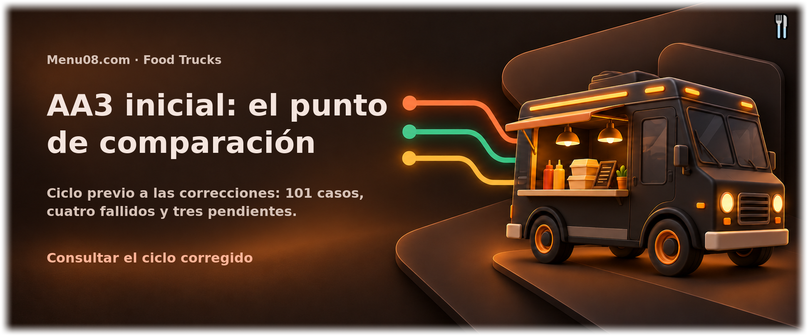

<!-- Menu08.com:header -->

<!-- /Menu08.com:header -->

# Ciclo inicial de AA3

Ejecuciones sobre el commit `9cd803c90f8a430a30027e27b7064943fdca6982`, anteriores a las correcciones de la rama `Lain`.

Se conservan 101 casos: 94 aprobados, 4 fallidos y 3 pendientes. Los casos fallidos fueron `CP-CARTA-08`, `CP-SEG-15`, `CP-AUTO-PM-01` y `CP-AUTO-PM-03`. Sus registros originales y las capturas permiten comparar la reejecución en `../actual/`.

Los nombres de rutas locales incluidos en los registros corresponden a la ubicación original de la actividad. Los archivos se trasladaron a este repositorio para conservar el historial; las imágenes referidas están en esta misma carpeta.

<!-- Menu08.com:footer -->

<!-- /Menu08.com:footer -->
